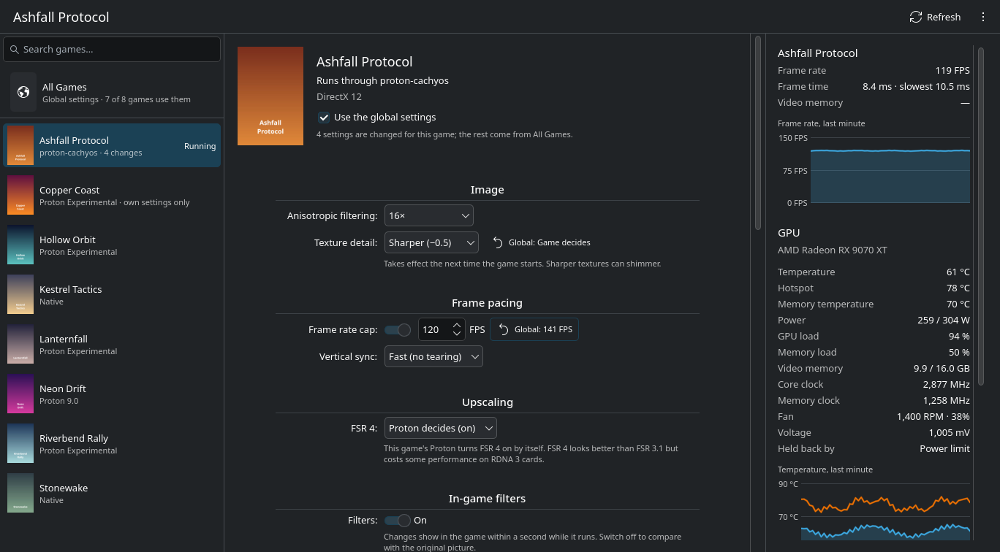
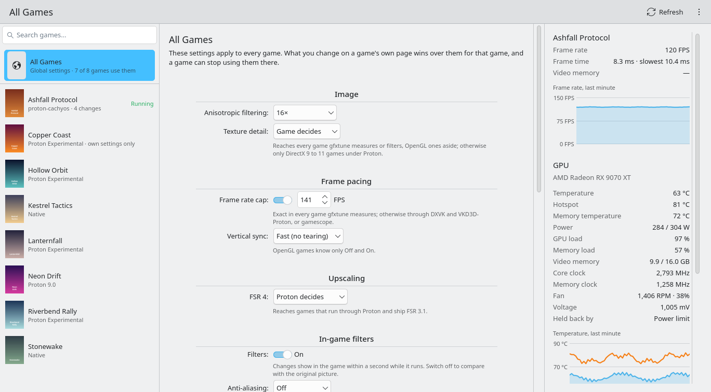
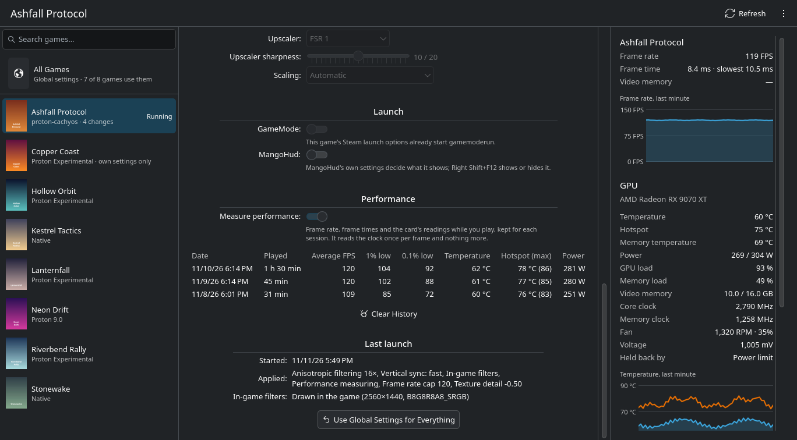

# gfxtune

**The graphics and game tuning app for CachyOS.** Steam games for now.

Graphics settings for all games and for each game, in-game filters, performance measuring and live GPU readings, in one window. Made with AMD Radeon cards in mind.

**Status: early development.**



On Windows, the GPU driver panel lets you set sharpening, anti-aliasing, frame caps and similar options for all games and for each game. Linux has the same building blocks (Mesa, DXVK, Proton, gamescope), but they are environment variables and config files spread across several projects. gfxtune puts them in one window: choose settings for all games, change what you want for a single game, and they apply the next time the game starts.

## What works so far

- Games from the native Steam client, with how each one runs (native or which Proton) and which graphics libraries it loads
- Global settings for all games; a game's own page changes any of them for that game, and a game can stop using them altogether
- For all games or per game: anisotropic filtering, texture detail (LOD bias), vertical sync mode (Vulkan and OpenGL), an exact frame cap, FSR 4 on or off for games that ship FSR 3.1, and an optional gamescope session, which can also draw the game larger than the screen and scale it down (supersampling)
- In-game filters: anti-aliasing (SMAA), sharpening (AMD FidelityFX CAS) and colour (brightness, contrast, gamma, saturation, vibrance, colour temperature), adjustable while the game runs
- Performance measuring: average frame rate, 1% and 0.1% lows, and the card's temperature and power for every play session
- GameMode and MangoHud, switched on for all games or per game when they are installed
- A read-only panel with the card's temperatures, power, clocks, load and what holds it back, the processor's load, temperature and clock, and the frame rate and video memory of the game being played

Still to come: visual effects for the in-game filters, and an in-game overlay of gfxtune's own (MangoHud can be switched on meanwhile).

Options that do not apply to a game, for example FSR 4 under a Proton build without it, are shown as unavailable on the game's page with the reason; the All Games page says which games a setting does not reach. Some Proton builds (Valve's Proton 11 and Experimental, proton-cachyos) turn FSR 4 on by themselves and others (GE-Proton) only when asked; gfxtune reads which from the build's own files, says so on the game's page, and lets you turn it on or off per game.

Not planned: recording, streaming or playtime tracking. Overclocking, undervolting and fan control are not part of the first version.

## All games and single games

"All Games", at the top of the game list, holds the settings for every game. A game's own page starts from them: each setting follows the global one until you change it for that game. A changed setting shows a button with the global value, such as "Global: 141 FPS", that puts it back; setting the same value again by hand does the same. Later changes on the All Games page still reach every setting a game did not change. AMD's driver panel on Windows works in a similar way: a game profile starts from the global settings, and what you change in it wins.

Unchecking "Use the global settings" on a game's page takes the game out of them: gfxtune then leaves it alone apart from its own changes. The game list shows how many settings a game changes, or "own settings only".

The button at the bottom of a game's page drops all of its changes; on the All Games page it puts the global settings back to gfxtune's defaults.



## How settings reach a game

gfxtune adds `gfxtune-run` to the Steam launch options of every installed game it has something to do in, right before `%command%`. Anything already there stays where it was: `gamemoderun %command% -dx12` becomes `gamemoderun gfxtune-run %command% -dx12`. Performance measuring is on for all games by default, so that is every game, except those where it has nothing to do: a native game that draws only with OpenGL, where the filters and measuring cannot go, with nothing else set, and a game taken out of the global settings without changes of its own.

Games with anti-cheat are handled more carefully. As long as any setting that runs inside games (an in-game filter or performance measuring) is on for all games, gfxtune does not add itself to a game with anti-cheat on its own, even though those settings would stay locked there. It goes in once you accept the risk on the game's page or change one of its settings there, or when no such global setting is on; settings applied from outside the game, such as anisotropic filtering, the frame cap or FSR 4, then reach it too. The game's page says when gfxtune holds back. Switching measuring off on the All Games page takes it out of every game with nothing else set.

When the game starts, `gfxtune-run` reads the global settings and the game's own changes, sets the matching options (Mesa, DXVK, VKD3D-Proton and Proton variables), starts gamescope if it is switched on, and then hands over to the game.

Steam rewrites its settings file from memory when it exits, so gfxtune only edits it while Steam is closed. If Steam is open, the change waits until it closes, and the game's page offers the line to paste in by hand. Only the one launch option is changed, and the result is read back and checked before it is saved.

Settings you put in a game's launch options yourself always win: if they already set a variable gfxtune would set, or already start gamescope, GameMode or MangoHud, gfxtune leaves that alone and says so on the game's page.

The frame cap uses one limiter, never two at once: gfxtune's layer (below) when it loads, which paces every Vulkan game, DirectX under Proton included, on an exact grid of frame times; otherwise DXVK and VKD3D-Proton for games under Proton, and for other games gamescope, whose cap only holds while the game waits for vertical sync. A native game that neither the layer nor gamescope reaches cannot be capped; its page says so. GameMode starts around everything, and MangoHud right around the game; inside gamescope, MangoHud's own layer is not supported, so gamescope shows it through its `mangoapp` instead.

## In-game filters and measuring

The filters are drawn by a small Vulkan layer that ships with gfxtune. When a game starts with a filter or performance measuring switched on, `gfxtune-run` asks Vulkan to load the layer into that game, and only that game; nothing else ever loads it. Just before each frame is shown, the layer copies the picture and draws it back filtered: anti-aliasing first (SMAA 1x, by Jimenez et al.), then sharpening and colour. It reads the global settings file and the game's own while the game runs, so moving a slider, on the game's page or on the All Games page, changes the picture within a second, and the Filters switch turns them off for comparing without losing the values.



For measuring, the layer reads the clock once per frame and counts the frame time into a histogram, in 0.1 ms steps up to 100 ms; pauses of a second or more, such as loading screens, are left out. The 1% and 0.1% lows are the frame rates that the slowest 1% and 0.1% of frames fall below. A background thread writes the last second for the card panel every second, and the whole session with the card's average temperature and power every five seconds. Sessions shorter than 20 seconds are dropped, and each game keeps its newest 50.

Vulkan games are reached directly, and DirectX games under Proton through DXVK and VKD3D-Proton, which draw with Vulkan. Games that draw with OpenGL are not, and neither is a game while it shows HDR; the game's page says so, and after a launch it shows whether the filters were drawn.

Some native games load their graphics library only while they run, so their files do not say what they draw with. When such a game runs for a minute with the layer in it and never shows a Vulkan picture, gfxtune notes that it draws with OpenGL (gfxtune has to be open while it runs to see this). From then on its filters and measuring show as unavailable, and it gets no launch option for measuring alone. If all the game showed in that minute was a launcher, "Check Again" next to its graphics on its page lets the next start decide again.

The layer runs inside the game, as MangoHud or vkBasalt do. No bans are known for this kind of layer, but nobody can promise there will never be one. In a game that ships anti-cheat (gfxtune looks for Easy Anti-Cheat, BattlEye and others in its folder, and for Valve Anti-Cheat in Steam's data) the filters and measuring stay locked until you accept that risk for that game. If an update adds anti-cheat to a game that already had filters, they stay locked, with their values kept, until you accept the risk for it. Setting `DISABLE_GFXTUNE_FILTERS=1` in a game's launch options keeps the layer out of it whatever its settings say.

## Removing gfxtune-run from Steam

To take `gfxtune-run` out of every game, for example before removing gfxtune, close Steam and run:

```
gfxtune --remove-launch-lines
```

The next time gfxtune's window opens with Steam closed, it adds the line back to the games it has something to do in.

## The card panel

The panel on the right shows the card's temperatures (edge, hotspot, memory), power and power limit, load, video memory, clocks, fan speed and voltage, with graphs of temperature and power over the last minute, and what the card's firmware says holds it back (power limit, current limit or a temperature). Below are the processor's load, temperature and average clock. While a game is being measured, its frame rate, frame times, video memory and a graph of its frame rate come first. The panel reads the amdgpu driver's files in `/sys` once a second, only while gfxtune's window is visible, and leaves a card that has gone to sleep alone rather than waking it to read it. If there are several AMD cards, the one with the most video memory is shown first.

## Where gfxtune keeps its settings

Settings are plain text files in `~/.config/gfxtune/`: `global.ini` for all games, and in `games/` one file per game with only what is the game's own: the settings changed for it, whether it uses the global settings, an accepted anti-cheat warning, and the anti-cheat gfxtune found in it (`gfxtune-run` reads that at launch). Files written by gfxtune 0.3 and older held every setting; the ones still at gfxtune's default are read as not changed, so those follow the global settings. What `gfxtune-run` applied at a game's last start is kept in `last-launch/`, and each game's measured sessions in `performance/`. gfxtune reads Steam's files where they are and never copies them.

"Remove All gfxtune Settings" in the menu deletes the `gfxtune` folder and nothing else, so everything goes back to gfxtune's defaults. Those measure every game, so the games keep `gfxtune-run`; to take it out of every game, switch measuring off on the All Games page, or use `gfxtune --remove-launch-lines` (above) before removing gfxtune.

## Installing on Arch Linux and CachyOS

```
git clone <this repository>
cd gfxtune/packaging/arch
makepkg -si
```

`makepkg` builds gfxtune, runs its tests (add `--nocheck` to skip them) and installs it with pacman, which pulls in the Qt and KDE libraries it needs. gfxtune then appears in the application menu as a settings program.

To remove it, close Steam and run `sudo pacman -R gfxtune`. Before anything is removed, gfxtune takes `gfxtune-run` out of every user's Steam launch options; if Steam is still open, the removal stops and asks you to close it first, so no game is left pointing at a program that is gone. gfxtune's own settings stay in `~/.config/gfxtune` until you delete that folder or use "Remove All gfxtune Settings" first.

## Building

Requirements: CMake 3.24 or newer, a C++20 compiler, Qt 6.8 or newer (Quick, Quick Controls 2, Widgets), KDE Kirigami, KDE's KI18n 6.21 or newer for translations, and KDE's KQuickCharts, which draws the graphs; all come with every Plasma desktop. The filter layer needs the Vulkan headers and `glslangValidator` to build, and the Vulkan loader for its tests. The card names come from libdrm's `amdgpu.ids`.

```
cmake -S . -B build -DCMAKE_BUILD_TYPE=Release
cmake --build build
ctest --test-dir build
```

Problems that do not show in the window, such as a Steam file that could not be read, are logged (in `journalctl --user` when gfxtune is started from the menu); `QT_LOGGING_RULES="gfxtune.*.debug=true" gfxtune` also logs what it does.

`gfxtune --list-games` prints the Steam games gfxtune finds and what it reads about each one (how it runs, which graphics libraries it loads, FSR 3.1, what its Proton does with FSR 4, anti-cheat, whether Steam has saved its cover, current launch options). It only reads, and is meant for checking a system or attaching to a bug report. `man gfxtune` and `man gfxtune-run` describe both programs.

## Testing

Every change is built and tested on CachyOS, in its official container image, with the scripts in `ci/`; [CONTRIBUTING.md](CONTRIBUTING.md) shows how to run them.

- The unit tests check each part on its own, on made-up Steam folders and programs; they never read a real Steam installation. The filter tests draw on the first Vulkan device they find (Mesa's software renderer works too) and compare every pixel with the same arithmetic done in C++; with Khronos' validation layer installed, it checks every Vulkan call as well.
- The system tests install the package and start small test games the way Steam does: a native Vulkan game, and DirectX 11 and 12 games under Proton (DXVK and VKD3D-Proton). They check what reaches the screen (filters, anti-aliasing, a slider moved while the game runs), the frame cap, measuring, the anti-cheat lock, GameMode and MangoHud, the launch options the window writes into Steam's file, and the removal hook.
- The unit tests also run with AddressSanitizer and UndefinedBehaviorSanitizer, and the package the system tests install is built with CachyOS's own compiler flags.

## Contributing

Bug reports, tests on other cards and games, translations and code are welcome; see [CONTRIBUTING.md](CONTRIBUTING.md). Security problems: [SECURITY.md](SECURITY.md). Changes between versions: [CHANGELOG.md](CHANGELOG.md).

## License

GPL-3.0-or-later. See [LICENSE](LICENSE). The sharpening filter follows AMD FidelityFX CAS, and the anti-aliasing is SMAA, both under the MIT licence; see [NOTICE.md](NOTICE.md).

AMD, Radeon and FSR are trademarks of Advanced Micro Devices, Inc. gfxtune is an independent project and is not affiliated with or endorsed by AMD.
